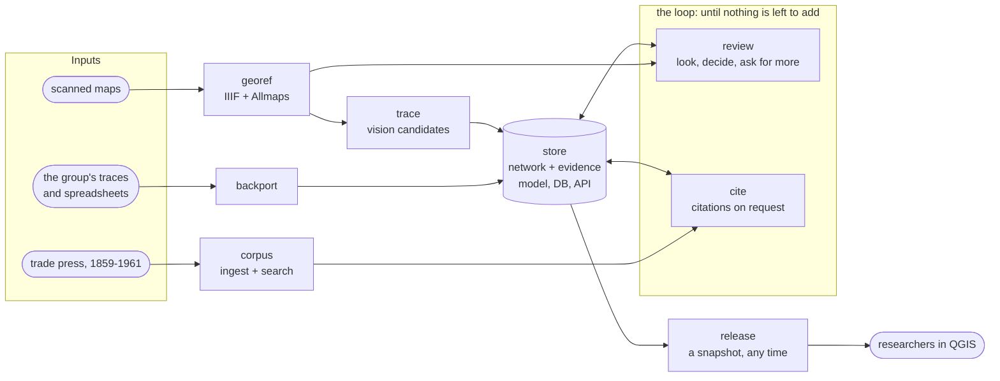

# Lineage

Lineage reconstructs the history of physical networks - gas and oil pipelines, electric
transmission, water mains, roads - as temporal GIS data recovered from the archival record.
Every fact about a line carries a citation to the source that says so.

The name is a pun (line + age) that also happens to be the GIS term for a dataset's
provenance, which is the whole idea.

Overview site: <https://lineage.tightlinesoftware.com>

It grew out of [Legend](https://github.com/Tight-Line/legend), a spike run with a
university research group. Their interest is a timeline of US energy distribution as an
input to research and policy. Tight Line's interest is the agentic extraction research.

This repository is the controlplane. It holds no code. It says which pieces exist, what goes
in and out of each, who needs them first, and where each one is built. It does not say how
they are built; that belongs in the component repos.

## What it has to do

In order of priority:

1. Data usable in QGIS and field-standard tools, without conversion or plugins.
2. Temporal, with imprecise dates.
3. Citations, optionally with confidence.
4. Trackable evolution - who changed what, when, and on what evidence.

(4) used to mean "the git history". It now means an audit trail in the database; see
[decisions](decisions.md) L-0001.

## The pieces

Sections go into `store` as soon as they are traced or imported, carrying whatever the trace
itself says. From then on `review` and `cite` work on what is stored, in a loop: a person
asks for citations on some sections, `cite` answers with candidates, the person accepts or
corrects them, and every accepted claim makes the next search better. A release can be
cut at any point in that loop. See L-0013.

| Repo | What it is | First needed |
| --- | --- | --- |
| [`store`](https://github.com/line-age/store) | the network + evidence model, PostGIS, the audited CRUD API | Now, first |
| [`corpus`](https://github.com/line-age/corpus) | trade-press ingest and an authority-ranked RAG search over it | Fall 2026 |
| [`cite`](https://github.com/line-age/cite) | sections in, grounded citations out | Fall 2026, first |
| [`georef`](https://github.com/line-age/georef) | IIIF image serving, self-hosted Allmaps and its APIs | Fall 2026 |
| [`trace`](https://github.com/line-age/trace) | georeferenced maps in, candidate traces out | Fall 2026, research |
| [`backport`](https://github.com/line-age/backport) | the group's existing traces and spreadsheets into `store` | Now, with `store` |
| [`review`](https://github.com/line-age/review) | the app the loop runs in: review, identity, citation requests, AI help | Winter 2027, started now |
| [`release`](https://github.com/line-age/release) | `store` out to versioned GeoPackage and GeoJSON, from any state | First cut with `backport` |
| [`deploy`](https://github.com/line-age/deploy) | generic Helm charts and synthetic fixture data | Fall 2026 |

## Projects and leads

Each repo has its own GitHub project in the `line-age` org, where its work is planned and
tracked, and a team lead who owns both. This table is the one place that says who; repo
READMEs link here. See L-0008.

| Repo | Project | Team lead |
| --- | --- | --- |
| `cite` | [Citations](https://github.com/orgs/line-age/projects/1) | [@bornakapusta](https://github.com/bornakapusta) |
| `corpus` | [Corpus](https://github.com/orgs/line-age/projects/2) | [@FlorenceEgwu](https://github.com/FlorenceEgwu) |
| `georef` | [Georef](https://github.com/orgs/line-age/projects/3) | [@nickmarden](https://github.com/nickmarden) |
| `store` | [Store](https://github.com/orgs/line-age/projects/4) | [@nickmarden](https://github.com/nickmarden) |
| `trace` | [Trace](https://github.com/orgs/line-age/projects/5) | [@tisljaricleo](https://github.com/tisljaricleo) |
| `backport` | [Backport](https://github.com/orgs/line-age/projects/6) | [@gregariouspanda](https://github.com/gregariouspanda) |
| `review` | [Review](https://github.com/orgs/line-age/projects/7) | [@ickynavigator](https://github.com/ickynavigator) |
| `release` | [Release](https://github.com/orgs/line-age/projects/8) | [@ickynavigator](https://github.com/ickynavigator) |
| `deploy` | [Infrastructure](https://github.com/orgs/line-age/projects/9) | [@sudosume](https://github.com/sudosume) |

The controlplane itself has no project; changes to it go through pull requests, managed by
[@nickmarden](https://github.com/nickmarden) and [@bornakapusta](https://github.com/bornakapusta).

Detail per component, including inputs, outputs and open questions, is in
[components.md](components.md). Timing is in [roadmap.md](roadmap.md).

## Where things are written down

- [components.md](components.md) - each piece, its inputs and outputs, what it depends on
- [roadmap.md](roadmap.md) - fall, winter, spring
- [decisions.md](decisions.md) - what we have decided for Lineage, and what we inherited from Legend
- [open-questions.md](open-questions.md) - what is not decided, and whose call it is
- [glossary.md](glossary.md) - the words, so every repo uses them the same way
- [ports.md](ports.md) - the host ports each repo binds locally, so everything can run at once
